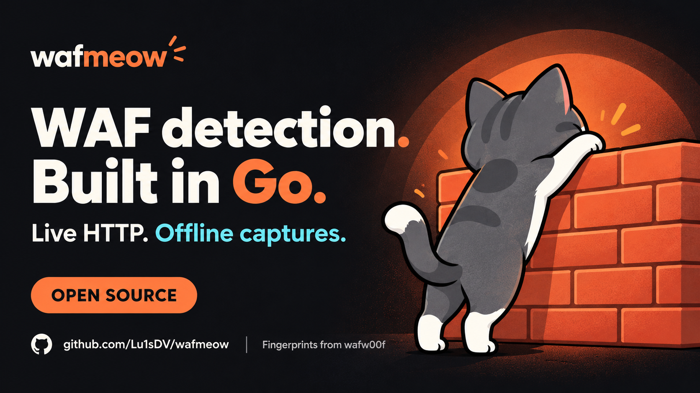

## It started as a Go exercise

Back in 2022, I was learning cybersecurity and wanted an excuse to get serious about Go. Goroutines and the language's approach to concurrency were what caught my attention. So I picked a Python security tool I liked, [wafw00f](https://github.com/EnableSecurity/wafw00f), and started porting its WAF fingerprints.

That experiment became **wafmeow**: a Go CLI and library with **172 WAF product identities** based on wafw00f's catalogue. The upstream fingerprint work deserves the credit. Porting the catalogue does not, by itself, guarantee identical probe coverage or detection accuracy.

## When a substring is enough

It wasn't just a language translation. While working through the signatures, I found cases where a regex was doing the job of a simple substring search. Some signatures really need a pattern; others only need to find a fixed token in a header or cookie.

For the literal case, the difference is as simple as switching from a regular expression to `strings.Contains` — once you've checked that the signature does not need regex features. Here's a tiny, separate Go benchmark using a **precompiled** regex:

```go
var header = "server: cloudflare; cache-control: no-cache"
var pattern = regexp.MustCompile(`cloudflare`)
var matched bool

func BenchmarkLiteralRegexp(b *testing.B) {
    var ok bool
    for i := 0; i < b.N; i++ { ok = pattern.MatchString(header) }
    matched = ok
}

func BenchmarkSubstring(b *testing.B) {
    var ok bool
    for i := 0; i < b.N; i++ { ok = strings.Contains(header, "cloudflare") }
    matched = ok
}
```

On a Linux/amd64 runner with **Go 1.23.2**, five 300 ms samples gave median times of **92.74 ns/op** (about 10.8 million operations/s) for the precompiled regex and **7.034 ns/op** (about 142 million operations/s) for the substring search. That's roughly **13× on one synthetic string**, not a benchmark of wafmeow or a reason to replace patterns that genuinely need regex. Network and probe time matter much more in a real scan.

## URLs in, JSONL out

The bigger goal was making WAF detection comfortable in a recon pipeline. In particular, I wanted it to play nicely with [ProjectDiscovery's httpx](https://github.com/projectdiscovery/httpx): discover live URLs, pipe them into a static Go binary, and stream structured results into the next stage. No Python virtual environment or intermediate response files required.

<picture>
  <source srcset="../../images/wafmeow-demo.png" media="(prefers-reduced-motion: reduce)" />
  
</picture>

*Demo: httpx feeds target URLs to wafmeow; a still image replaces the animation when reduced motion is preferred.*

Here's the machine-readable version for **hosts you're authorized to test**:

```sh
httpx -l authorized-hosts.txt -silent |
  wafmeow --target-file - --fast --jsonl --silent
```

Each stage makes its own network requests, so its concurrency and rate limits need to be configured independently. Results distinguish matches from insufficient evidence: `INCOMPLETE` means the scanner could not reach a confident verdict, **not** that the target has no WAF.

## A few other useful modes

- **`--fast`** makes a quick active pass with three request roles.
- **`--deep`** (the default) uses eight request roles for broader probing.
- **`--baseline`** inspects the normal response without active probes.
- **`--evidence`** classifies saved responses without new HTTP requests. It can also import supported httpx response exports with `--evidence-format httpx`.

There's an importable [Go library](https://github.com/Lu1sDV/wafmeow/blob/main/docs/library.md) too, for when a subprocess isn't the right boundary.

## Speed, measured with caveats

Here are the **median wall-clock times from three runs** on 30–31 October 2026: 600 live targets on a four-vCPU Debian 13 VPS, comparing wafw00f 2.4.2 with wafmeow fast and deep modes. For wafw00f, concurrency means separate CLI processes; for wafmeow, target workers.

| Workers / processes | wafw00f 2.4.2 | wafmeow fast | wafmeow deep |
| ---: | ---: | ---: | ---: |
| 1 | 31m 37.6s | 7m 49.5s | 15m 50.5s |
| 5 | 6m 53.3s | 2m 18.2s | 3m 10.3s |
| 10 | 4m 46.8s | 1m 15.8s | 1m 34.8s |
| 50 | 1m 59.4s | 16.1s | 26.6s |
| 100 | 1m 52.2s | 9.0s | 21.9s |

At 100 workers, those are **12.45×** (fast) and **5.12×** (deep) observed elapsed-time ratios relative to wafw00f. They aren't proof of equivalent work or accuracy: the tools use different probes, TLS policies and body limits. At that concurrency, wafmeow returned 600 rows but reported **69–71 incomplete** in fast mode and **72–77 incomplete** in deep mode; wafw00f returned **580–581** targets without an equivalent completion state.

The full [benchmark methodology and result accounting](https://github.com/Lu1sDV/wafmeow/blob/main/docs/benchmarks.md#600-target-vps-comparison) is public. These numbers describe that particular run, not a universal speedup.

## Try it

With a supported Go toolchain, or via the [Homebrew tap](https://github.com/Lu1sDV/homebrew-tap):

```sh
go install github.com/Lu1sDV/wafmeow/v3/cmd/wafmeow@latest
# or
brew install Lu1sDV/tap/wafmeow
```

The [repository](https://github.com/Lu1sDV/wafmeow) has the [CLI guide](https://github.com/Lu1sDV/wafmeow/blob/main/docs/usage.md), [wafw00f migration notes](https://github.com/Lu1sDV/wafmeow/blob/main/docs/migrating-from-wafw00f.md), and a way to report reproducible fingerprint mismatches.

A port is a starting point, not the finish line. What I care about next is verifying the fingerprints against real evidence and making the pipeline easier to trust.
